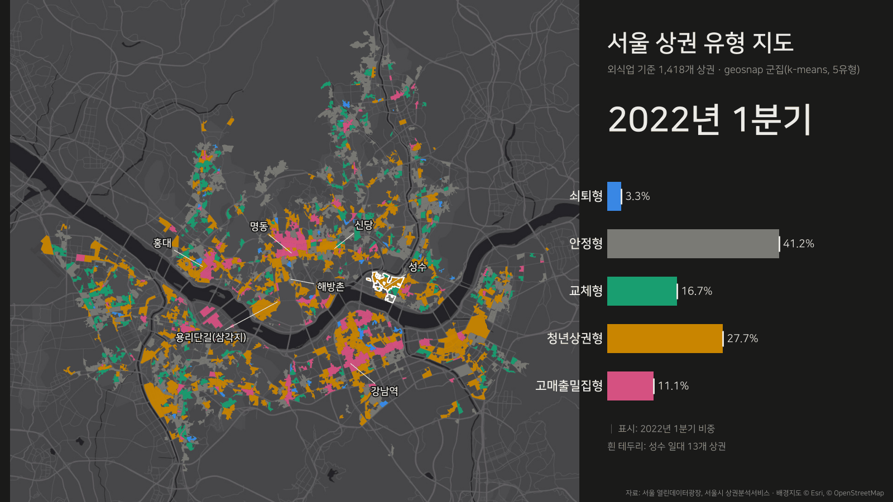
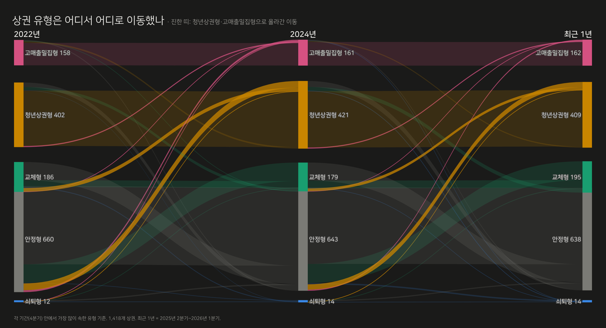
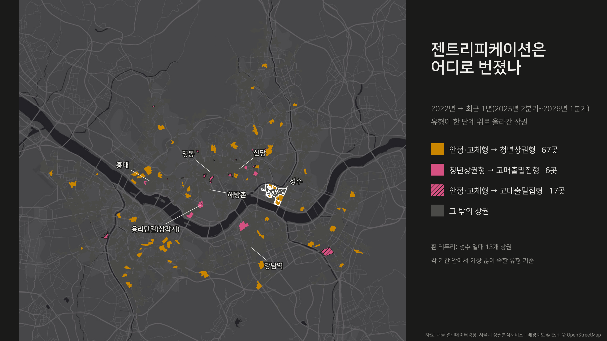
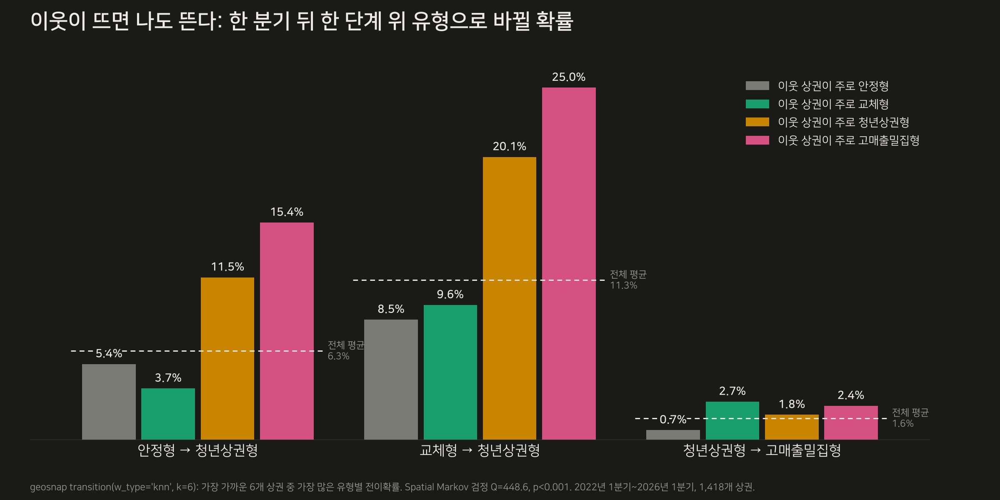
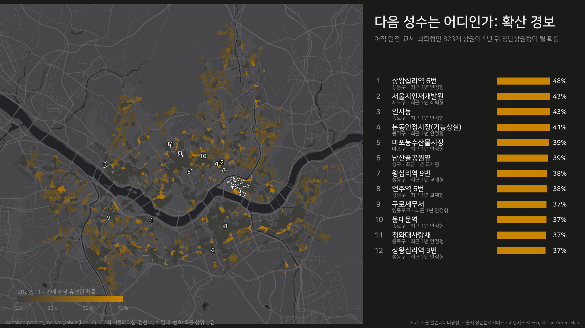
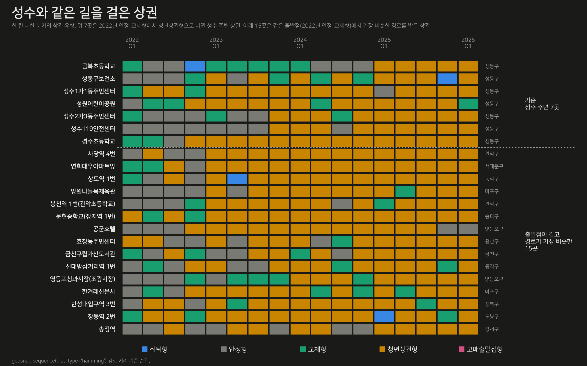

# seoul-gentrification-early-warning

"다음 성수동은 어디인가" — 서울시 상권 젠트리피케이션 조기경보 실험.
실험설계서: [docs/experiment_design.md](docs/experiment_design.md)

## 진행 상황
- [x] 0단계: 설계서 등록, `CLAUDE.md`, geosnap 설치·API 확인 ([docs/api_notes.md](docs/api_notes.md))
- [x] 1단계: 원자료 수집 ([reports/step1_collection.md](reports/step1_collection.md)) — 7종 중 6종, 2021Q1~2026Q2
- [x] 2단계: seoul_commerce 전처리(집객시설 제외)와 데이터 점검 ([reports/data_audit.md](reports/data_audit.md)) — 연속 관측 상권 1,418개
- [x] 3단계: 어댑터, geosnap 입력 자료와 변수 정의 ([docs/variables.md](docs/variables.md)) — 1,418개 상권 × 17분기, 결측 없음
- [x] 4단계: 유형화(5유형)와 전이확률 ([reports/step4_types.md](reports/step4_types.md))
- [x] 5단계: 변화 경로, 조기경보, 변화 핫스팟 ([reports/step5_paths_warning.md](reports/step5_paths_warning.md))
- [ ] 6단계 이후: 미진행

## 주요 그림 (4단계)








## 주요 그림 (5단계)




## 사용한 외부 저장소
| 저장소 | 버전 | 라이선스 | 용도 |
|---|---|---|---|
| [oturns/geosnap](https://github.com/oturns/geosnap) | v0.17.0 (`61f9537`) | BSD-3-Clause | 분석 엔진 |
| [scksh/seoul_commerce](https://github.com/scksh/seoul_commerce) | `b44d8f8` (git 하위 모듈 `external/seoul_commerce`) | README상 MIT (LICENSE 파일 없음) | 서울 데이터 수집·전처리 |

인용: Knaap, E., & Rey, S. (2024). geosnap: The Geospatial Neighborhood Analysis Package. *Proc. SciPy 2024*. https://doi.org/10.25080/FVWM4182

데이터 출처: 서울 열린데이터광장, 서울시 상권분석서비스 (공공누리 제1유형)

## 재현
```bash
git submodule update --init
(cd external/seoul_commerce && uv sync)
python3 -m venv .venv
.venv/bin/pip install -r requirements.txt
.venv/bin/python run/00_api_smoke_test.py
# 원자료(저장소에 포함) -> seoul_commerce 형식
.venv/bin/python adapters/opendata_to_contract.py data/raw/seoul_opendata data/raw/contract
# seoul_commerce 전처리 (집객시설 제외)
(cd external/seoul_commerce && uv run python ../../run/02_preprocess.py ../../data/raw/contract ../../data/processed/seoul_commerce)
# geosnap 입력 자료 (결과 data/processed/geosnap_panel.parquet은 저장소에 포함)
.venv/bin/python adapters/seoul_to_geosnap.py
# 4단계: 유형 수 비교, 유형화·전이확률, 그림 (그림에는 한글 글꼴 fonts-nanum과 배경지도 접속 필요)
.venv/bin/python run/04a_find_k.py reports/step4/find_k.csv
.venv/bin/python run/04b_types_transitions.py reports/step4
.venv/bin/python run/04c_figures.py reports/step4 reports/figures/step4
# 5단계: 경로, 예측(300회, 약 12분), LINC, 그림
.venv/bin/python run/05a_paths.py reports/step5 reports/figures/step5
.venv/bin/python run/05b_predict.py reports/step5 300 17
.venv/bin/python run/05c_lincs.py reports/step5
.venv/bin/python run/05d_figures.py reports/step5 reports/figures/step5
```
